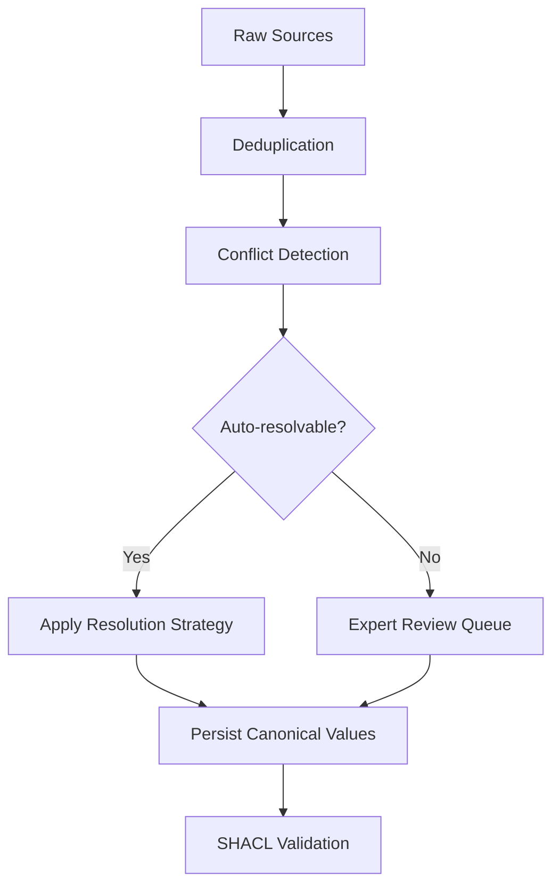

`ConflictDetector` 会呈现多个来源对同一规范实体存在分歧的属性，`ConflictResolver` 则按属性应用相应策略——可信度加权投票、最新优先、专家复核等——产出单一消解值，并附带完整审计轨迹。请在去重之后、SHACL 校验之前运行。

<Info>
请在去重之后、SHACL 校验之前运行冲突检测。去重负责移除重复节点；冲突消解负责调和同一规范实体上相互矛盾的属性值。若顺序颠倒——在去重之前检测冲突——就会在本应先合并的实体之间产生虚假冲突。
</Info>

## 什么是冲突消解？

当您合并来自多个来源的数据时，同一个现实世界实体——一位客户、一件产品、一个威胁行为者、一种药物化合物——往往带有相互矛盾的属性值。一个数据库显示某客户的邮箱是 `alice@example.com`；另一个显示为 `alice.smith@example.com`。一个安全情报源将某个 CVE 评为 10.0；另外两个分别评为 9.1 和 9.5。

**冲突消解**是一个系统性过程：判定哪个值最可信，并用证据记录该判定，从而使规范实体上每个属性最终都得到一个可辩护、可审计的值。

### 核心概念

**规范实体**——现实世界事物的唯一权威记录。去重之后，每个实体在图中恰好对应一个规范节点。冲突消解决定哪些属性值应归属到该节点上。

**冲突值**——同一规范实体的同一属性上存在两个或多个不同的断言值，且每个值由不同来源报告。

**可信度分数**——您为每条来源记录附加的 0.0 到 1.0 之间的数值，表示该来源的可靠程度。政府注册表可能取 0.99；抓取的博客可能取 0.30。这些分数由您提供，Semantica 在 `CREDIBILITY_WEIGHTED` 消解过程中使用它们。

**置信度分数**——消解完成后由消解器*计算*出的 0.0 到 1.0 之间的数值，反映结果的确信程度。一致投票会产生高置信度；可信度相同的来源之间出现接近的票数分裂，则产生较低置信度。该值出现在 `ResolutionResult.confidence` 上，应作为信号来解读，而非消解值一定正确的保证。

**消解策略**——选取胜出值的规则：多数投票、可信度加权平均、最新时间戳等等。完整列表见[消解策略一览](#resolution-strategies-at-a-glance)。

**审计轨迹**——每一次消解决策的完整记录：冲突 ID、所用策略、消解值、参与咨询的来源以及置信度分数。由 `resolver.get_resolution_history()` 返回。

**溯源感知消解**——不仅记录胜出值，还记录其来源的消解方式。每个 `ResolutionResult` 都带有 `sources_used` 字段，因此您始终可以追溯规范值的来源——这在受监管环境中至关重要。

## 为什么使用冲突消解？

- **多源管道必然产生分歧。** 更新节奏、录入惯例与来源可靠性上的差异无法避免。若没有显式的消解步骤，您就会在无任何记录的情况下悄然偏向某一个来源。
- **您将获得可辩护、可审计的决策日志。** 合规团队、审计人员和领域专家需要知道哪个来源胜出以及原因。审计轨迹正好提供这一点。
- **容易的情形自动处理，困难的情形升级处理。** 常规分歧——名称拼写略有差异、时间戳过期——由算法消解。真正含糊的情形——相互竞争的法律分类、不同的临床终点——会被标记出来交给专家复核，同时不阻塞管道其余部分。

## 何时使用 / 何时不使用

**在以下情况下使用冲突消解：**
- 您正在为同一实体合并两个或多个独立来源。
- 来源之间在属性值上存在分歧，而您需要一个唯一的规范值。
- 您需要每一次消解决策的可审计记录。
- 部分冲突需要领域专家复核后才能消解。

**在以下情况下跳过冲突消解：**
- **已存在单一的权威来源。** 如果某个系统对给定属性始终正确，直接从中读取即可。围绕单一来源搭建消解机制只会增加复杂性而无收益。
- **所有来源始终一致。** 跳过之前应通过实证验证这一点；实践中静默分歧十分常见。
- **您希望保留所有冲突值。** 如果保留每个来源的断言比选定一个更重要，请直接在您的图模式中建模溯源，而不是消解出唯一胜出值。

## 典型工作流



1. **去重**——合并重复节点，使每个实体恰好只有一条规范记录。冲突消解作用于单个规范实体；在比较不同来源对该实体的说法之前，必须先识别出该实体。参见[去重](/zh/guides/deduplication)。
2. **冲突检测**——调用 `detect_entity_conflicts()` 一次性呈现所有属性分歧，或调用 `detect_value_conflicts()` 针对特定属性进行检测。
3. **消解**——对每个冲突应用策略（`CREDIBILITY_WEIGHTED`、`MOST_RECENT`、`VOTING` 等），或将其转交专家复核（`EXPERT_REVIEW`）。
4. **持久化规范值**——将消解后的值写回规范实体或图存储。参见[持久化消解值](#persisting-resolved-values)。
5. **SHACL 校验**——对消解后的图施加结构约束，确认其满足您的本体。参见[SHACL 校验](/zh/guides/shacl-validation)。

## 快速上手：入门示例

在深入特定领域场景之前，这里给出最短的 API 使用路径。三个系统——一个 CRM、一个 ERP 和一个 LDAP 目录——持有同一客户略有差异的联系信息。三者中有两个一致认为规范邮箱是 `alice.smith@example.com`；CRM 持有的是较旧的值。

```python
from semantica.conflicts import ConflictDetector, ConflictResolver, ResolutionStrategy

# Same customer, three sources — only email disagrees
customer_records = [
    {"id": "cust-001", "source": "crm",  "email": "alice@example.com",       "phone": "+1-555-0100"},
    {"id": "cust-001", "source": "erp",  "email": "alice.smith@example.com", "phone": "+1-555-0100"},
    {"id": "cust-001", "source": "ldap", "email": "alice.smith@example.com", "phone": "+1-555-0100"},
]

# Step 1: Detect all property conflicts at once — no need to name each property
detector = ConflictDetector()
conflicts = detector.detect_entity_conflicts(customer_records)

print(f"Conflicts found: {len(conflicts)}")
for c in conflicts:
    print(f"  Property : {c.property_name}")
    print(f"  Values   : {c.conflicting_values}")
    print(f"  Severity : {c.severity}")

# Step 2: Resolve — two out of three sources agree, so majority vote wins
resolver = ConflictResolver()
results = resolver.resolve_conflicts(conflicts, strategy=ResolutionStrategy.VOTING)

for r in results:
    print(f"\n[{'RESOLVED' if r.resolved else 'REVIEW'}] {r.conflict_id}")
    print(f"  Resolved value : {r.resolved_value}")
    print(f"  Strategy       : {r.resolution_strategy}")
    print(f"  Confidence     : {r.confidence:.0%}")
    print(f"  Sources used   : {r.sources_used}")
```

```text
Conflicts found: 1
  Property : email
  Values   : ['alice@example.com', 'alice.smith@example.com', 'alice.smith@example.com']
  Severity : medium

[RESOLVED] cust-001_email_conflict
  Resolved value : alice.smith@example.com
  Strategy       : voting
  Confidence     : 67%
  Sources used   : ['crm', 'erp', 'ldap']
```

`detect_entity_conflicts()` 自动扫描了 `email` 和 `phone` 两者——您并没有点名它们。由于 `phone` 在全部三条记录中完全相同，因此未检测到相关冲突。邮箱分歧消解为 `alice.smith@example.com`，因为三个来源中有两个一致支持该值。

当一批冲突都应使用同一策略时，直接向 `resolve_conflicts()` 传入 `strategy=`。当不同的实体-属性对需要不同策略时，请使用 `set_resolution_rule()`——详见[设置按属性的消解规则](#setting-per-property-resolution-rules)。

## 检测冲突

`ConflictDetector` 提供三种方法。请选择适合您情况的那一种：

| 方法 | 扫描内容 | 使用时机 |
| :--- | :--- | :--- |
| `detect_entity_conflicts(entities)` | 一次性检查每个实体上的所有属性 | 首轮检查；您事先并不知道哪些属性存在冲突 |
| `detect_value_conflicts(entities, property_name)` | 跨所有实体的一个具名属性 | 针对已知热点属性的定向检查 |
| `detect_relationship_conflicts(relationships)` | 同一节点对之间的边类型 | 图边上的结构性分歧 |

### 一次性扫描所有属性——`detect_entity_conflicts`

对于新管道，`detect_entity_conflicts()` 是推荐的起点。它会检查实体记录上出现的每一个属性，并返回一个包含所有冲突的扁平列表——您无需事先枚举属性。

```python
detector = ConflictDetector()
all_conflicts = detector.detect_entity_conflicts(records)
# Returns every conflict across every property in one call
```

如果您为特定实体类型注册过冲突字段，可传入 `entity_type` 将检测限制在这些字段上：

```python
# Limit detection to fields registered for this entity type
all_conflicts = detector.detect_entity_conflicts(records, entity_type="vulnerability")
```

未指定 `entity_type` 时，检测器会检查实体字典上的每个键（排除 `id`、`source` 和 `metadata` 等簿记字段）。先从这里入手获得完整全貌，然后再决定哪些冲突需要哪种消解策略。

### 扫描特定属性——`detect_value_conflicts`

当您已经明确要检查哪个属性，或希望对每个属性应用不同的检测逻辑时，请使用 `detect_value_conflicts()`。`ConflictDetector` 按实体 ID 对记录分组，然后比较每个来源在该属性上的值。任何实体只要有至少两个来源报告不同的值，就会产生一个 `Conflict` 对象。

```python
from semantica.conflicts import ConflictDetector, ConflictResolver, ResolutionStrategy

# Three authoritative sources on the same CVE — all credible, all disagreeing
cve_records = [
    {
        "id": "cve-2024-3400",
        "source": "nvd",
        "cvss_score": 10.0,
        "exploit_status": "unconfirmed",
        "vector": "AV:N/AC:L/PR:N/UI:N/S:C/C:H/I:H/A:H",
        "metadata": {"timestamp": "2024-04-11T12:00:00Z"},
    },
    {
        "id": "cve-2024-3400",
        "source": "commercial_feed",
        "cvss_score": 9.1,
        "exploit_status": "in_wild",
        "vector": "AV:N/AC:L/PR:N/UI:N/S:U/C:H/I:H/A:H",
        "metadata": {"timestamp": "2024-04-12T15:30:00Z"},
    },
    {
        "id": "cve-2024-3400",
        "source": "vendor_paloalto",
        "cvss_score": 9.5,
        "exploit_status": "in_wild",
        "vector": "AV:N/AC:H/PR:N/UI:N/S:C/C:H/I:H/A:H",
        "metadata": {"timestamp": "2024-04-12T12:00:00Z"},
    },
]

detector = ConflictDetector()

# Detect disagreements on the CVSS score property
score_conflicts = detector.detect_value_conflicts(cve_records, property_name="cvss_score")
exploit_conflicts = detector.detect_value_conflicts(cve_records, property_name="exploit_status")

print(f"CVSS score conflicts  : {len(score_conflicts)}")
print(f"Exploit status conflicts: {len(exploit_conflicts)}")

for c in score_conflicts:
    print(f"\nConflict: {c.conflict_id}")
    print(f"  Entity   : {c.entity_id}")
    print(f"  Property : {c.property_name}")
    print(f"  Values   : {c.conflicting_values}")   # [10.0, 9.1, 9.5]
    print(f"  Severity : {c.severity}")              # 'medium' — numeric difference < 1000
    print(f"  Sources  : {[s['document'] for s in c.sources]}")
    print(f"  Action   : {c.recommended_action}")
```

```text
CVSS score conflicts  : 1
Exploit status conflicts: 1

Conflict: cve-2024-3400_cvss_score_conflict
  Entity   : cve-2024-3400
  Property : cvss_score
  Values   : [10.0, 9.1, 9.5]
  Severity : medium
  Sources  : ['nvd', 'commercial_feed', 'vendor_paloalto']
  Action   : Multiple conflicting values detected. Manual review recommended.
```

每个 `Conflict` 都记录了完整信息：哪个实体、哪个属性、所有有分歧的值，以及每个值由哪个源报告。这已足以构建一个复核队列——但目标是按照你设定的规则自动解析这些冲突。

## 设置按属性解析规则

`set_resolution_rule(entity_id, property_name, strategy)` 为特定的实体-属性组合注册一种策略。解析器会把规则存储在键 `entity_id.property_name` 下，并在你调用 `resolve_conflicts()` 时自动应用。

由于规则同时以实体 ID 和属性名作为键，`set_resolution_rule()` 是实体特定的。不存在能将规则一次性应用于所有实体或所有属性的通配符。

**何时使用 `set_resolution_rule()`：** 当不同的实体-属性组合需要不同的策略时使用它。例如，某实体的 `legal_name` 可能使用 `CREDIBILITY_WEIGHTED`，而其 `last_updated` 使用 `MOST_RECENT`。按组合注册规则，可以让单次 `resolve_conflicts()` 调用在一趟中正确处理所有这些组合。

**何时直接将 `strategy=` 传给 `resolve_conflicts()`：** 如果某一批次中的每个冲突都应使用相同策略，就直接把它传给 `resolve_conflicts()`，而不是为每个实体-属性对注册规则：

```python
# Same strategy for every conflict — no per-property rules needed
results = resolver.resolve_conflicts(all_conflicts, strategy=ResolutionStrategy.CREDIBILITY_WEIGHTED)
```

这比为每个实体循环调用 `set_resolution_rule()` 只为在所有地方应用同一策略要更简洁。

**针对 CVE 示例的按属性规则：**

```python
resolver = ConflictResolver()

# Register source credibility scores so CREDIBILITY_WEIGHTED can use them
resolver.source_tracker.set_source_credibility("nvd", 0.98)
resolver.source_tracker.set_source_credibility("commercial_feed", 0.91)
resolver.source_tracker.set_source_credibility("vendor_paloalto", 0.87)

# For this CVE, NVD is the most authoritative source on scoring.
# CREDIBILITY_WEIGHTED uses the registered source credibility 
# to weight the vote — NVD at 0.98 will dominate over the commercial feed at 0.91.
resolver.set_resolution_rule(
    "cve-2024-3400",
    "cvss_score",
    ResolutionStrategy.CREDIBILITY_WEIGHTED,
)

# Exploitation status is time-sensitive: the commercial feed and vendor have both
# observed in-the-wild exploitation, which is more current than NVD's initial
# unconfirmed assessment. MOST_RECENT picks the value from the source with the
# latest timestamp in its metadata.
resolver.set_resolution_rule(
    "cve-2024-3400",
    "exploit_status",
    ResolutionStrategy.MOST_RECENT,
)
```

你可以在检测之前或之后设置规则——解析器会在调用 `resolve_conflicts()` 时惰性应用它们。

## 解析批次

将所有检测到的冲突传给 `resolve_conflicts()`。对于每个冲突，解析器会查找是否为该实体-属性组合注册了规则。若找到规则，就应用该策略。若未设置，则回退到默认策略（投票，除非你在构造函数中覆盖了它）。

```python
all_conflicts = score_conflicts + exploit_conflicts

results = resolver.resolve_conflicts(all_conflicts)

for r in results:
    status = "RESOLVED" if r.resolved else "REVIEW REQUIRED"
    print(f"[{status}] {r.conflict_id}")
    print(f"  Resolved value : {r.resolved_value}")
    print(f"  Strategy used  : {r.resolution_strategy}")
    print(f"  Confidence     : {r.confidence:.0%}")
    print(f"  Sources used   : {r.sources_used}")
    print(f"  Notes          : {r.resolution_notes}")
    print()
```

```text
[RESOLVED] cve-2024-3400_cvss_score_conflict
  Resolved value : 10.0
  Strategy used  : credibility_weighted
  Confidence     : 36%
  Sources used   : ['nvd', 'commercial_feed', 'vendor_paloalto']
  Notes          : Resolved by credibility-weighted voting (weight: 0.98)

[RESOLVED] cve-2024-3400_exploit_status_conflict
  Resolved value : in_wild
  Strategy used  : most_recent
  Confidence     : 80%
  Sources used   : ['commercial_feed']
  Notes          : Resolved by most recent value
```

NVD 在 CVSS 评分上胜出——其可信度权重（0.98）略微超过商业数据源（0.91）和厂商（0.87），因此 10.0 成为权威评分。利用状态解析为 `in_wild`——商业数据源和厂商公告都比 NVD 的初步研判更新，且二者都报告了在野利用。

## 处理需要人工判断的冲突

并非每个冲突都能自动解析。关于金融工具法律分类的分歧，或关于患者当前用药清单的分歧，后果过于重大，不适合由算法解决。将这些冲突标记为待复核，同时不阻塞批次中的其余部分：

```python
from semantica.conflicts import ConflictDetector, ConflictResolver, ResolutionStrategy

# Drug trial data: efficacy agreed, primary endpoint disputed
trial_records = [
    {"id": "dapagliflozin", "source": "declare_timi58",
     "primary_endpoint": "MACE",               "hba1c_reduction_pct": 0.54},
    {"id": "dapagliflozin", "source": "dapa_hf",
     "primary_endpoint": "HF_hospitalization", "hba1c_reduction_pct": 0.48},
    {"id": "dapagliflozin", "source": "meta_analysis",
     "primary_endpoint": "HbA1c_reduction",    "hba1c_reduction_pct": 0.52},
]

detector = ConflictDetector()
efficacy_conflicts  = detector.detect_value_conflicts(trial_records, "hba1c_reduction_pct")
endpoint_conflicts  = detector.detect_value_conflicts(trial_records, "primary_endpoint")

resolver = ConflictResolver()

# Register source credibility scores
resolver.source_tracker.set_source_credibility("declare_timi58", 0.92)
resolver.source_tracker.set_source_credibility("dapa_hf", 0.95)
resolver.source_tracker.set_source_credibility("meta_analysis", 0.88)

# Efficacy: credibility-weighted across trials — the meta-analysis (0.88) and
# the two RCTs (0.92, 0.95) will produce a weighted resolution.
resolver.set_resolution_rule(
    "dapagliflozin", "hba1c_reduction_pct", ResolutionStrategy.CREDIBILITY_WEIGHTED
)

# Primary endpoint: each trial measured a different thing. This is not a conflict
# to auto-resolve — a clinician must decide which endpoint applies to the use case.
resolver.set_resolution_rule(
    "dapagliflozin", "primary_endpoint", ResolutionStrategy.EXPERT_REVIEW
)

all_conflicts = efficacy_conflicts + endpoint_conflicts
results = resolver.resolve_conflicts(all_conflicts)

auto_resolved = [r for r in results if r.resolved]
for_review    = [r for r in results if not r.resolved]

print(f"Auto-resolved : {len(auto_resolved)}")
print(f"Expert review : {len(for_review)}")

# Export the review queue for the clinical team
import json
review_queue = [
    {
        "conflict_id": r.conflict_id,
        "notes": r.resolution_notes,
        "metadata": r.metadata,
    }
    for r in for_review
]
with open("expert_review_queue.json", "w") as fh:
    json.dump(review_queue, fh, indent=2, default=str)
```

```text
Auto-resolved : 1
Expert review : 1   # primary_endpoint — EXPERT_REVIEW means resolved=False
```

`EXPERT_REVIEW` 会在结果上设置 `resolved=False`。该冲突在图里保持未解析状态，metadata 字段带有 `requires_expert_review: True`，复核队列 JSON 为你的临床团队提供了做出判断所需的确切信息。

## 持久化已解析的值

`resolve_conflicts()` 返回 `ResolutionResult` 对象——它不会自动将已解析的值写回你的图或实体存储。这一步需要你使用管线所用的任何存储层来实现。

最直接的做法是将每个 `ResolutionResult` 与其原始 `Conflict` 对象配对——两个列表按相同顺序返回——并把胜出的值写入你的权威实体：

```python
# canonical_entity is your authoritative record — a dict, graph node, database row, etc.
canonical_entity = {"id": "cve-2024-3400", "cvss_score": None, "exploit_status": None}

for conflict, result in zip(all_conflicts, results):
    if result.resolved:
        canonical_entity[conflict.property_name] = result.resolved_value
        # Log provenance: record which source this value came from
        print(f"  {conflict.property_name} = {result.resolved_value} "
              f"(from {result.sources_used}, confidence {result.confidence:.0%})")

# Persist canonical_entity to your graph store, database, or downstream system.
```

```text
  cvss_score = 10.0 (from ['nvd', 'commercial_feed', 'vendor_paloalto'], confidence 36%)
  exploit_status = in_wild (from ['commercial_feed'], confidence 80%)
```

需要牢记几点：

- **`resolved=False` 的冲突**——已标记为专家或人工复核——在人工做出判断之前不应写入权威记录。将它们保留在复核队列中。
- **置信度是信号，不是保证。** 72% 的置信度分数意味着解析器对其决策拥有合理但并非一致的证据。在生产写入之前，对低置信度结果应加以额外审查。
- **跟踪溯源。** `result.sources_used` 告诉你哪个源的值胜出。若你的合规要求需要完整的证据链，请将其与权威值一起存储。

## 审查完整审计轨迹

一次解析运行结束后，`get_resolution_history()` 会返回自解析器实例化以来做出的每个决策。这就是你的合规日志：

```python
history = resolver.get_resolution_history()

print(f"Total resolutions logged: {len(history)}")
for r in history:
    status = "RESOLVED" if r.resolved else "PENDING"
    print(f"[{status}] {r.conflict_id}")
    print(f"  Strategy   : {r.resolution_strategy}")
    print(f"  Value      : {r.resolved_value}")
    print(f"  Confidence : {r.confidence:.0%}")
```

将此与检测器的完整冲突报告配合使用，可获得跨所有运行的聚合统计：

```python
report = detector.get_conflict_report()

print(f"Total conflicts detected  : {report['total_conflicts']}")
print(f"By type                   : {report['by_type']}")
print(f"By severity               : {report['by_severity']}")
# Total conflicts detected  : 6
# By type                   : {'value_conflict': 6}
# By severity               : {'medium': 6}
```

该报告聚合检测器在其生命周期内见过的每个冲突——对于管线监控以及识别哪些实体类型或数据源产生最多分歧很有用。

## 检测关系冲突

值冲突存在于属性上。关系冲突存在于边上——两个源对同一节点对之间的连接做出相互矛盾的断言：

```python
# Two intelligence sources disagree about whether APT29 exploits this CVE
relationships = [
    {"source": "apt29", "target": "cve-2024-3400",
     "type": "EXPLOITS",     "origin": "mandiant"},
    {"source": "apt29", "target": "cve-2024-3400",
     "type": "UNRELATED_TO", "origin": "crowdstrike"},
]

rel_conflicts = detector.detect_relationship_conflicts(relationships)
for c in rel_conflicts:
    print(f"Relationship conflict: {c.conflict_id}")
    print(f"  Edge type values: {c.conflicting_values}")
    print(f"  Severity: {c.severity}")
```

关系冲突通常需要专家复核而非投票，因为相互冲突的边类型往往反映出真正不同的情报评估，而不是数据录入错误。

## 领域示例

<Tabs>

<Tab title="国防——CTI/威胁情报">

某威胁情报平台合并来自 Mandiant、CrowdStrike 和一个开源博客的攻击者画像。三个源一致认为 APT29 属于俄罗斯且具有间谍动机，但在其首次观测时间上存在分歧，并且——关键在于——其中一个源将其归因于中国。当可信度高的源（Mandiant 0.95、CrowdStrike 0.92）意见一致时，低可信度源（该博客，0.30）应当落败。

可信度加权解析能干净利落地处理这种情况：博客的错误归因被两家权威厂商的合计权重所淹没。`first_seen` 日期的分歧（2008 与 2009）同样按可信度权重解析，Mandiant 的 2008 年胜出。

```python
from semantica.conflicts import ConflictDetector, ConflictResolver, ResolutionStrategy

actor_profiles = [
    {"id": "apt29", "source": "mandiant",    "nation_state": "Russia",
     "first_seen": "2008"},
    {"id": "apt29", "source": "crowdstrike", "nation_state": "Russia",
     "first_seen": "2009"},
    {"id": "apt29", "source": "oss_blog",    "nation_state": "China",  # wrong
     "first_seen": "2015"},
]

detector = ConflictDetector()
nation_conflicts     = detector.detect_value_conflicts(actor_profiles, "nation_state")
first_seen_conflicts = detector.detect_value_conflicts(actor_profiles, "first_seen")

resolver = ConflictResolver()
resolver.source_tracker.set_source_credibility("mandiant", 0.95)
resolver.source_tracker.set_source_credibility("crowdstrike", 0.92)
resolver.source_tracker.set_source_credibility("oss_blog", 0.30)

resolver.set_resolution_rule("apt29", "nation_state", ResolutionStrategy.CREDIBILITY_WEIGHTED)
resolver.set_resolution_rule("apt29", "first_seen",   ResolutionStrategy.CREDIBILITY_WEIGHTED)

results = resolver.resolve_conflicts(nation_conflicts + first_seen_conflicts)
for r in results:
    print(f"{r.conflict_id}: {r.resolved_value!r}  [{r.confidence:.0%} confidence]")
    # apt29_nation_state_conflict: 'Russia'  [86% confidence]
    # apt29_first_seen_conflict:   '2008'    [44% confidence]
    # The blog's China attribution (weight 0.30) loses to Mandiant+CrowdStrike (0.95+0.92).

history = resolver.get_resolution_history()
print(f"Audit log entries: {len(history)}")
```

</Tab>

<Tab title="安全——SOC/事件响应">

某漏洞管理系统针对同一 CVE 摄取来自 NVD、MITRE 和厂商公告的 CVSS 评分。NVD 和 MITRE 都具有权威性；而厂商有保守评分的自身利益。可信度加权解析使 NVD（0.98）和 MITRE（0.96）压过厂商（0.90），产生反映独立权威机构共识的权威评分。

CVSS 向量字符串也存在冲突——作用域字段（`S:C` 与 `S:U`）反映出真正不同的解读分歧，这影响该 CVE 是否被归类为网络跳板风险。两个冲突都采用相同的可信度加权处理。

```python
from semantica.conflicts import ConflictDetector, ConflictResolver, ResolutionStrategy

cve_records = [
    {"id": "cve-2024-3400", "source": "nvd",
     "cvss_score": 10.0, "vector": "AV:N/AC:L/PR:N/UI:N/S:C/C:H/I:H/A:H"},
    {"id": "cve-2024-3400", "source": "mitre",
     "cvss_score": 9.8,  "vector": "AV:N/AC:L/PR:N/UI:N/S:U/C:H/I:H/A:H"},
    {"id": "cve-2024-3400", "source": "paloalto",
     "cvss_score": 9.5,  "vector": "AV:N/AC:H/PR:N/UI:N/S:C/C:H/I:H/A:H"},
]

detector = ConflictDetector()
score_conflicts  = detector.detect_value_conflicts(cve_records, "cvss_score")
vector_conflicts = detector.detect_value_conflicts(cve_records, "vector")

resolver = ConflictResolver()
resolver.source_tracker.set_source_credibility("nvd", 0.98)
resolver.source_tracker.set_source_credibility("mitre", 0.96)
resolver.source_tracker.set_source_credibility("paloalto", 0.90)

resolver.set_resolution_rule(
    "cve-2024-3400", "cvss_score", ResolutionStrategy.CREDIBILITY_WEIGHTED
)
resolver.set_resolution_rule(
    "cve-2024-3400", "vector", ResolutionStrategy.CREDIBILITY_WEIGHTED
)

results = resolver.resolve_conflicts(score_conflicts + vector_conflicts)
for r in results:
    if r.resolved:
        print(f"Canonical {r.conflict_id.split('_')[2]}: {r.resolved_value}  "
              f"({r.confidence:.0%} confidence)")
    # Canonical cvss_score: 10.0   (35% confidence)  — NVD wins
    # Canonical vector: AV:N/AC:L/PR:N/UI:N/S:C/C:H/I:H/A:H  (35% confidence)
```

</Tab>

<Tab title="生命科学——临床/制药">

某药物安全知识图谱合并来自三项研究的 dapagliflozin 试验数据：DECLARE-TIMI 58、DAPA-HF 和一项荟萃分析。HbA1c 降幅值在各试验间不同，因为每项试验纳入的人群不同。主要终点不同，因为每项试验旨在回答不同的临床问题——这是真正的科学差异，而非数据错误。

疗效数字可按可信度加权；有争议的终点必须交由专家复核。这种拆分处理——能自动解析的就自动解析，不能的就升级——是受监管数据环境的范式。

```python
from semantica.conflicts import ConflictDetector, ConflictResolver, ResolutionStrategy

drug_records = [
    {"id": "dapagliflozin", "source": "declare_timi58",
     "hba1c_reduction_pct": 0.54, "primary_endpoint": "MACE"},
    {"id": "dapagliflozin", "source": "dapa_hf",
     "hba1c_reduction_pct": 0.48, "primary_endpoint": "HF_hospitalization"},
    {"id": "dapagliflozin", "source": "meta_analysis",
     "hba1c_reduction_pct": 0.52, "primary_endpoint": "HbA1c_reduction"},
]

detector = ConflictDetector()
efficacy_conflicts = detector.detect_value_conflicts(drug_records, "hba1c_reduction_pct")
endpoint_conflicts = detector.detect_value_conflicts(drug_records, "primary_endpoint")

resolver = ConflictResolver()
resolver.source_tracker.set_source_credibility("declare_timi58", 0.92)
resolver.source_tracker.set_source_credibility("dapa_hf", 0.95)
resolver.source_tracker.set_source_credibility("meta_analysis", 0.88)

resolver.set_resolution_rule(
    "dapagliflozin", "hba1c_reduction_pct", ResolutionStrategy.CREDIBILITY_WEIGHTED
)
resolver.set_resolution_rule(
    "dapagliflozin", "primary_endpoint", ResolutionStrategy.EXPERT_REVIEW
    # resolved=False — queued for clinician review, not auto-resolved
)

results = resolver.resolve_conflicts(efficacy_conflicts + endpoint_conflicts)
auto   = [r for r in results if r.resolved]
review = [r for r in results if not r.resolved]

print(f"Auto-resolved  : {len(auto)}")
for r in auto:
    print(f"  {r.conflict_id}: {r.resolved_value}  [{r.confidence:.0%}]")
    # dapagliflozin_hba1c_reduction_pct_conflict: 0.48  [35%]

print(f"Expert queue   : {len(review)}")
for r in review:
    print(f"  {r.conflict_id} — {r.resolution_notes}")
    # dapagliflozin_primary_endpoint_conflict — Flagged for expert review
```

</Tab>

<Tab title="银行——风险/合规">

某信用风险图合并来自 CRM、全球 LEI 注册表和征信机构的企业客户数据。LEI 注册表是实体名称和行业代码的法定权威——其可信度应设为 1.0（或视为确切无疑）。CRM 和征信机构的名称可能过时或为缩写；而 LEI 注册表拥有官方注册的法定名称。

为 `legal_name` 和 `sic_code` 设置 `CREDIBILITY_WEIGHTED` 解析，并让 LEI 注册表持有 0.99 的可信度分数，可确保法律上具有权威性的值始终胜出，并为下一次监管检查保留完整的审计证据。

```python
from semantica.conflicts import ConflictDetector, ConflictResolver, ResolutionStrategy

client_records = [
    {"id": "corp-acme-uk", "source": "crm",
     "legal_name": "ACME UK Ltd",                "sic_code": "7372"},
    {"id": "corp-acme-uk", "source": "lei_registry",
     "legal_name": "ACME United Kingdom Limited", "sic_code": "7371"},
    {"id": "corp-acme-uk", "source": "credit_bureau",
     "legal_name": "ACME UK Ltd",                "sic_code": "7372"},
]

detector = ConflictDetector()
name_conflicts = detector.detect_value_conflicts(client_records, "legal_name")
sic_conflicts  = detector.detect_value_conflicts(client_records, "sic_code")

resolver = ConflictResolver()
resolver.source_tracker.set_source_credibility("lei_registry", 0.99)
resolver.source_tracker.set_source_credibility("credit_bureau", 0.50)
resolver.source_tracker.set_source_credibility("crm", 0.40)

resolver.set_resolution_rule(
    "corp-acme-uk", "legal_name", ResolutionStrategy.CREDIBILITY_WEIGHTED
)
resolver.set_resolution_rule(
    "corp-acme-uk", "sic_code", ResolutionStrategy.CREDIBILITY_WEIGHTED
)

results = resolver.resolve_conflicts(name_conflicts + sic_conflicts)
for r in results:
    print(f"Canonical {r.conflict_id.split('_')[1]}: {r.resolved_value!r}  "
          f"[{r.confidence:.0%}]")
    # Canonical legal_name: 'ACME United Kingdom Limited'  [52%]  — LEI registry wins
    # Canonical sic_code:   '7371'                         [52%]  — LEI registry wins

# Aggregate conflict statistics for the compliance report
report = detector.get_conflict_report()
print(f"\nConflict audit:")
print(f"  Total detected : {report['total_conflicts']}")
print(f"  By severity    : {report['by_severity']}")
```

</Tab>

</Tabs>

## 冲突解决策略一览

| 策略 | 决策方式 | 适用场景 |
| :--- | :--- | :--- |
| `VOTING` | 出现频率最高的值胜出 | 有 3 个及以上独立来源；没有明确的权威来源 |
| `CREDIBILITY_WEIGHTED` | 按来源的 `credibility_score` 对值加权 | 各来源的可靠性排名已知 |
| `MOST_RECENT` | 采用时间戳最新的来源所提供的值 | 数据衰减很快——威胁情报、市场价格 |
| `FIRST_SEEN` | 采用最先断言该值的来源所提供的值 | 主来源比派生来源更可靠 |
| `HIGHEST_CONFIDENCE` | 采用 `confidence` 字段最高的来源所提供的值 | 自动抽取器会为每条记录输出置信度分数 |
| `MANUAL_REVIEW` | 标记冲突；`resolved=False` | 数据量小、决策风险高 |
| `EXPERT_REVIEW` | 标记并转入领域专家队列；`resolved=False` | 需要科学或法律层面的消歧 |

## 常见陷阱

**在去重之前运行冲突解决**
如果同一现实实体的重复节点仍然存在，`ConflictDetector` 会把每个重复节点视为与其他节点意见不一的独立实体——从而产生本不该存在的虚假冲突。务必先运行去重。

**忘记持久化已解决的值**
`resolve_conflicts()` 返回 `ResolutionResult` 对象，但不会把它们写入任何位置。如果只是查看结果，却没有更新你的规范实体，那么数据实际上没有任何改变。请参阅[持久化已解决的值](#persisting-resolved-values)。

**在大型实体集上逐条扫描属性**
在手动循环中为每个属性调用 `detect_value_conflicts()` 会造成对数据的重复遍历。请改用 `detect_entity_conflicts()`——它在一次调用中处理所有属性，是批量检测的推荐起点。

**误解可信度分数**
可信度分数是你基于对来源可靠性的先验认识而赋予的权重，并非事实真相。以 `set_source_credibility("source", 0.99)` 注册的来源仍然可能出错。`CREDIBILITY_WEIGHTED` 解决会放大你对来源质量的信念；如果这些信念校准失准，解决结果也会随之失准。在生产环境中依赖这些分数之前，请先对照已知的事实真相进行验证。

**把已解决的值当作必然正确的真相**
已解决的值只是在给定来源和策略下最站得住脚的答案，未必就是正确答案。低置信度分数和 `EXPERT_REVIEW` 标记都是信号，提示你在把结果写入规范记录或下游系统之前应当仔细审查。

**在已有单一权威来源时使用冲突解决**
如果某个系统在给定属性上始终正确，直接读取它即可。在单一来源之上叠加冲突解决只会增加复杂度、引入不必要的疑虑，并产生不携带任何真实信息的审计轨迹。

**通过循环注册规则来统一应用同一种策略**
仅为对所有实体-属性对应用同一策略而对每个实体-属性对调用 `set_resolution_rule()`，会带来 O(N) 的设置开销却毫无收益。当一种策略覆盖整个批次时，请直接将 `strategy=` 传给 `resolve_conflicts()`。

## 相关指南

- [去重](/zh/guides/deduplication) — 在运行冲突检测之前移除重复节点
- [溯源](/zh/guides/provenance) — 追踪每个已解决的值来自哪个来源，并以密码学方式验证审计轨迹
- [SHACL 校验](/zh/guides/shacl-validation) — 在冲突解决后强制实施结构约束
- [变更管理](/zh/guides/change-management) — 在冲突解决运行前后对图做快照
- [本体管理](/zh/guides/ontology) — 将实体类型对齐到共享词表，以减少模式层面的类型冲突